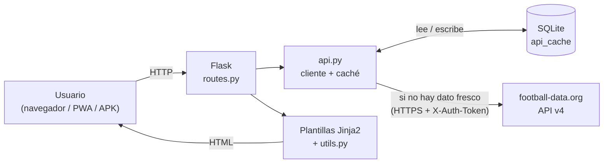
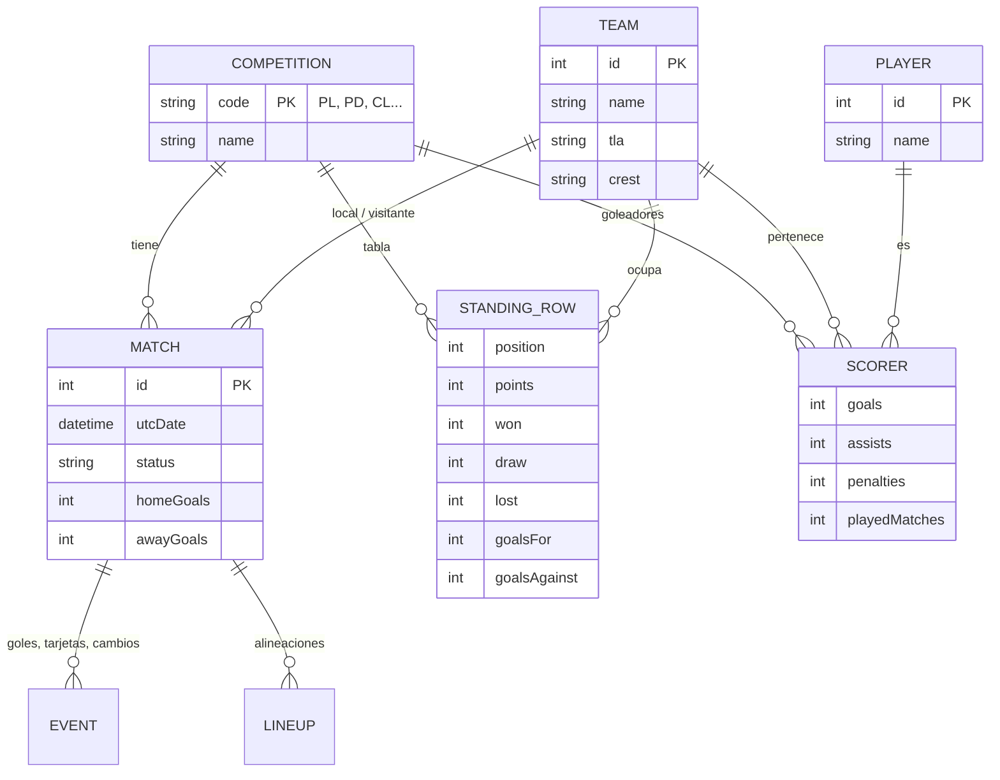

# DOCUMENTACION_ENTREGABLES — GolStats

> Guía definitiva y lista de verificación de la documentación para la entrega formal del proyecto.
## Índice

1. [Información General del Proyecto](#1-información-general-del-proyecto)
2. [Documentación Técnica y Arquitectura](#2-documentación-técnica--arquitectura)
3. [Manual de Instalación y Despliegue](#3-manual-de-instalación-y-despliegue-deployment)
4. [Manual de Usuario / Funcional](#4-manual-de-usuario--funcional)
5. [Checklist de Calidad y Entrega](#5-checklist-de-calidad-y-entrega)
6. [Anexos](#6-anexos)

---

## 1. Información General del Proyecto

### 1.1 Ficha del proyecto

| Campo | Valor |
|---|---|
| **Título** | GolStats — Aplicación web/móvil de consulta de fútbol |
| **Versión** | 1.0.0 |
| **Fecha de entrega** | `[ 16/11/2026]` |
| **Desarrollador/es** | `[Uriel Baez]` |
| **Institución / Materia** | `[DES. SOFT. PLAT. MOVILES]` |
| **Profesor/a evaluador/a** | `[German Rodriguez]` |
| **Repositorio** | `[https://github.com/bruhmomentlolxd/GolStats]` |
| **URL de producción** | `[ Solo entorno local |
| **Lenguaje principal** | Python 3 |

### 1.2 Resumen del alcance

GolStats permite consultar información de competiciones reales de fútbol, con una interfaz oscura inspirada en aplicaciones deportivas (tipo Promiedos / SofaScore). Funciona desde computadora y celular, y puede instalarse como aplicación (PWA / APK).

**Incluido en esta versión (v1.0.0):**

- **Partidos del día** de las 12 competiciones del plan gratuito de football-data.org, con navegación por fecha, filtro "En vivo" y actualización automática cada 60 s cuando hay partidos en juego.
- **Competiciones:** Champions League, Premier League, LaLiga, Serie A, Bundesliga, Ligue 1, Eredivisie, Primeira Liga, Championship, Brasileirão Série A, Copa del Mundo y Eurocopa.
- **Por competición:** tabla de posiciones, estadísticas personales (goles, asistencias, penales, promedio de goles por partido, partidos jugados) y panel de partidos por fecha/ronda con acceso a "Partidos actuales".
- **Por partido:** resumen (goles, tarjetas, cambios) y alineaciones con formación y suplentes, cuando la API los provee.
- **Datos automáticos** desde la API football-data.org, con **caché en SQLite** (respeta el límite de 10 consultas/minuto y permite mostrar el último dato guardado si la API falla).
- **App instalable (PWA)** con soporte sin conexión parcial; guía para generar APK; instalador `.bat` para Windows.

### 1.3 Fuera de alcance (decisiones de diseño)

| Elemento | Estado | Motivo |
|---|---|---|
| Usuarios, registro, login y roles | No implementado | La app es de solo lectura y pública |
| Panel de administración / carga manual de resultados | Futuro | Los resultados provienen automáticamente de la API |
| Liga Profesional Argentina | No incluida | No forma parte del plan gratuito de football-data.org |
| Remates por jugador, estadísticas avanzadas, predicciones | No incluidos | La API gratuita no los provee |
| Pruebas automatizadas (pytest) | No incluidas | Se verifica con el checklist manual de la sección 5 |
| Docker / Vercel / Supabase | No aplica | Ver sección 3.3 |

---

## 2. Documentación Técnica & Arquitectura

### 2.1 Descripción de la arquitectura

**Estilo:** aplicación monolítica con renderizado en servidor (*server-side rendering*). No es una SPA ni expone una API REST propia: el servidor consulta una API externa, arma el HTML con plantillas y lo entrega al navegador.

| Capa | Tecnología | Archivos |
|---|---|---|
| **Frontend** | HTML + plantillas Jinja2, CSS responsive (tema oscuro), JavaScript sin frameworks, PWA (manifest + service worker) | `templates/`, `static/css/style.css`, `static/js/main.js`, `static/manifest.webmanifest`, `static/sw.js` |
| **Backend** | Python 3 + Flask 3 (rutas, lógica, cliente HTTP con `requests`) | `app.py`, `routes.py`, `api.py`, `utils.py`, `config.py` |
| **Servidor de aplicación** | `waitress` (Windows / local), `gunicorn` (Linux / producción) | `run.py`, `render.yaml` |
| **Base de datos** | SQLite (archivo `instance/futbol.db`), usada como **caché** de la API | `db.py`, `schema.sql` |
| **Fuente de datos** | API REST football-data.org v4 (plan gratuito) | `api.py` |



**Flujo de una petición (con caché):**

1. El navegador pide una página (ej. `/competiciones/PL`).
2. `routes.py` pide los datos a `api.py` (tabla, partidos, goleadores).
3. `api.py` busca la respuesta en la tabla `api_cache`:
   - Si es **reciente** (según su TTL) → la usa, sin consultar internet.
   - Si es **vieja o no existe** → consulta football-data.org, guarda la respuesta y la usa.
   - Si la consulta **falla** y hay un dato guardado → lo muestra con un aviso ("Mostrando los últimos datos guardados").
4. `utils.py` normaliza los datos (hora argentina UTC-3, traducciones al español, agrupación por fechas/rondas).
5. Se renderiza la plantilla HTML y se responde al navegador.

**Estructura de carpetas:**

```
futbol_app/
├── app.py                  # Crea la app Flask, filtros Jinja, cabeceras de seguridad
├── config.py               # Configuración, lista de competiciones, lectura de .env
├── api.py                  # Cliente football-data.org + caché SQLite + TTL
├── db.py / schema.sql      # Conexión SQLite y definición de tablas
├── routes.py               # Rutas (páginas, manifest, service worker, healthz)
├── utils.py                # Fechas, traducciones, normalización de datos
├── run.py                  # Arranque de escritorio (waitress + ventana de app)
├── iniciar.bat             # Instalador/lanzador Windows (doble clic)
├── iniciar_para_celular.bat
├── crear_acceso_directo.bat
├── render.yaml             # Despliegue en Render
├── requirements.txt        # Dependencias Python
├── .env                    # Secretos locales (NO se sube al repositorio)
├── templates/              # base, index, competitions, competition, match, error, 404
└── static/                 # css, js, icons, manifest.webmanifest, sw.js
```

### 2.2 Especificación de APIs / Endpoints

#### 2.2.1 Rutas propias de la aplicación

La app responde HTML (no JSON). Todas son `GET`.

| Ruta | Parámetros (query) | Descripción | Respuesta |
|---|---|---|---|
| `/` | `fecha=AAAA-MM-DD` (opcional, por defecto hoy) · `ver=vivo` (opcional) | Partidos del día agrupados por competición | 200 HTML · 503 si la API falla sin datos guardados |
| `/competiciones` | — | Listado de las 12 competiciones | 200 HTML |
| `/competiciones/<code>` | `ronda=N` (opcional, índice de fecha/ronda) | Tabla, estadísticas personales y panel de partidos por fecha. `<code>`: `CL, PL, PD, SA, BL1, FL1, DED, PPL, ELC, BSA, WC, EC` | 200 HTML · 404 si el código no existe · 503 si todo falla |
| `/partido/<id>` | `tab=resumen\|alineaciones` | Detalle del partido (`<id>` numérico de football-data.org) | 200 HTML · 404 · 503 |
| `/healthz` | — | Comprobación de vida (no consulta la API) | 200 `ok` |
| `/manifest.webmanifest` | — | Manifiesto PWA | 200 `application/manifest+json` |
| `/sw.js` | — | Service worker (servido desde la raíz) | 200 `application/javascript` |
| `/.well-known/assetlinks.json` | — | Verificación del APK (opcional; solo si existe `assetlinks.json`) | 200 JSON · 404 |
| `/static/*` | — | CSS, JS e iconos | 200 |

**Manejo de errores:** `404` página "no encontrada" · `500` página de error genérica · errores de la API → pantalla amigable con el motivo (sin conexión, límite de consultas, plan sin acceso, API key inválida).

#### 2.2.2 API externa consumida — football-data.org v4

- **Documentación oficial (equivale al Swagger/Postman de este proyecto):** https://www.football-data.org/documentation/quickstart
- **Base URL:** `https://api.football-data.org/v4`
- **Autenticación:** cabecera HTTP `X-Auth-Token: <FOOTBALL_API_KEY>`
- **Límite del plan gratuito:** 10 consultas por minuto → mitigado con caché.

| Endpoint externo | Uso en GolStats | Parámetros | TTL de caché |
|---|---|---|---|
| `GET /matches` | Partidos del día (se piden día y día siguiente por la diferencia UTC / hora argentina y se filtra localmente) | `dateFrom`, `dateTo` | 60 s (hoy) · 15 min (futuro) · 1 h (pasado) |
| `GET /competitions` | Logos (`emblem`) de las competiciones | — | 24 h |
| `GET /competitions/{code}/standings` | Tabla de posiciones | — | 10 min |
| `GET /competitions/{code}/scorers` | Estadísticas personales | `limit=50` | 30 min |
| `GET /competitions/{code}/matches` | Partidos por fecha/ronda | — | 10 min |
| `GET /matches/{id}` | Detalle: eventos y alineaciones | — | 6 h si terminó · 60 s si no |

**Códigos de respuesta y tratamiento en la app:**

| HTTP | Significado | Comportamiento de GolStats |
|---|---|---|
| 200 | OK | Guarda en caché y muestra |
| 401 | API key inválida | Mensaje "La API key es incorrecta o fue revocada" |
| 403 | Recurso fuera del plan gratuito | Mensaje "Tu plan gratuito no incluye este dato" (p. ej. alineaciones) |
| 404 | No existe | Página 404 |
| 429 | Límite de consultas superado | Muestra datos guardados (si hay) con aviso, o mensaje de espera |
| Sin red | Sin conexión | Muestra datos guardados (si hay) con aviso |

### 2.3 Modelo de datos (esquema de base de datos)

**Motor:** SQLite · **Archivo:** `instance/futbol.db` (se crea automáticamente al iniciar).

La base de datos **no almacena entidades de negocio propias**: guarda una **caché** de respuestas JSON de la API. Esto evita duplicar datos que pertenecen a la fuente externa y mantiene la app simple de mantener.

```sql
CREATE TABLE IF NOT EXISTS api_cache (
    cache_key  TEXT PRIMARY KEY,   -- endpoint + parámetros ordenados. Ej: /competitions/PL/standings?
    payload    TEXT NOT NULL,      -- respuesta JSON completa de la API
    fetched_at REAL NOT NULL       -- instante de descarga (segundos Unix)
);
```

| Campo | Tipo | Restricción | Descripción |
|---|---|---|---|
| `cache_key` | TEXT | PRIMARY KEY | Ej.: `/matches?dateFrom=2026-11-14&dateTo=2026-11-15` |
| `payload` | TEXT | NOT NULL | JSON devuelto por football-data.org |
| `fetched_at` | REAL | NOT NULL | Se compara con el TTL de cada endpoint para decidir si está "fresco" |

Mantenimiento: borrar la caché con `flask --app app clear-cache`, o eliminando `instance/futbol.db`.

**Modelo lógico de los datos mostrados** (proviene de la API; *no está persistido en tablas*):



> En una futura versión con panel de administración, estas entidades pasarían a tablas propias (`competitions`, `teams`, `matches`) con las columnas `source` y `external_id` para distinguir datos de la API de los cargados manualmente.

### 2.4 Variables de entorno y archivo `.env.example`

| Variable | Obligatoria | Descripción | Dónde se define |
|---|---|---|---|
| `FOOTBALL_API_KEY` | **Sí** | Token personal de football-data.org | `.env` (local) · panel de Render (producción) |
| `SECRET_KEY` | Recomendada en producción | Clave interna de Flask (por defecto usa una de desarrollo) | Render la genera sola (`generateValue`) |
| `PYTHON_VERSION` | Solo Render | Versión de Python del servidor | `render.yaml` (3.12.7) |
| `PORT` | Solo hosting | Puerto asignado por la plataforma (lo usa `gunicorn`) | Lo inyecta Render |
| `GOLSTATS_LAN` | No | `1` = permite acceso desde otros dispositivos de la red (celular) | `iniciar_para_celular.bat` |
| `GOLSTATS_NO_BROWSER` | No | `1` = no abre la ventana automáticamente | Opcional |

Si una variable ya existe en el sistema, **tiene prioridad** sobre la del archivo `.env`.

**Archivo `.env.example`** (plantilla que SÍ se sube al repositorio; el `.env` real **nunca**):

```dotenv
# Copiar este archivo como ".env" y completar los valores.
# Obtener la API key gratis en: https://www.football-data.org/client/register

# (Obligatoria) Token de football-data.org
FOOTBALL_API_KEY=pegar_aqui_tu_token

# (Opcional) Clave interna de Flask. En producción usar un valor largo y aleatorio.
# SECRET_KEY=cambiar-por-un-valor-aleatorio

# (Opcional) Permitir acceso desde el celular en la misma red WiFi
# GOLSTATS_LAN=1
```

---

## 3. Manual de Instalación y Despliegue (Deployment)

### 3.1 Requisitos previos del sistema

| Requisito | Versión / detalle | ¿Obligatorio? |
|---|---|---|
| Python | 3.10 o superior (desarrollado y verificado con 3.13) | Sí |
| pip | Incluido con Python | Sí |
| Sistema operativo | Windows 10/11 (instalador `.bat`), Linux o macOS (manual) | Sí |
| Conexión a internet | Para instalar dependencias y consultar la API | Sí |
| API key de football-data.org | Gratuita, registro en https://www.football-data.org/client/register | Sí |
| Navegador | Microsoft Edge o Google Chrome (recomendado, para modo app/PWA) | Recomendado |
| Git y cuenta de GitHub | Solo para publicar en producción | Producción |
| Cuenta de Render (o VPS propio) | Solo para producción | Producción |
| Node.js, Docker | **No requeridos** | No |

Dependencias Python (`requirements.txt`): `Flask>=3.0`, `requests>=2.31`, `waitress>=3.0`, `gunicorn>=22.0` (solo Linux).

### 3.2 Entorno local — paso a paso

#### Opción A — Windows, sin consola (recomendada)

1. Instalar **Python 3.10+** desde https://www.python.org/downloads/ marcando **"Add Python to PATH"**.
2. Descomprimir el proyecto. Verificar que exista el archivo `.env` con `FOOTBALL_API_KEY=...` (o copiar `.env.example` como `.env`). Si falta, `iniciar.bat` pide la key.
3. Hacer **doble clic en `iniciar.bat`**. La primera vez crea el entorno virtual e instala las dependencias (1–2 min).
4. Se abre GolStats en una ventana propia. Para cerrar: cerrar la ventana negra.
5. *(Opcional)* Ejecutar `crear_acceso_directo.bat` para tener el ícono en el Escritorio.

#### Opción B — Manual (Windows / Linux / macOS)

```bash
# 1. Entrar a la carpeta del proyecto
cd futbol_app

# 2. Crear y activar el entorno virtual
python -m venv venv
venv\Scripts\activate            # Windows (cmd)
# source venv/bin/activate       # Linux / macOS

# 3. Instalar dependencias
pip install -r requirements.txt

# 4. Configurar la API key
copy .env.example .env           # Windows   (Linux/macOS: cp .env.example .env)
# Editar .env y pegar el token en FOOTBALL_API_KEY

# 5. Iniciar
python run.py                    # servidor de uso normal
# python app.py                  # SOLO desarrollo (modo debug). No usar en producción.
```

Abrir **http://127.0.0.1:5000** (si el puerto está ocupado, `run.py` usa el siguiente libre y lo muestra en pantalla).

#### Ver la app desde el celular en la misma red WiFi

1. Ejecutar `iniciar_para_celular.bat` (o `GOLSTATS_LAN=1 python run.py`).
2. Aceptar el aviso del Firewall de Windows ("Permitir acceso").
3. En el celular abrir la dirección que muestra la consola (ej. `http://192.168.1.20:5000`).

#### Verificación de la instalación

- [ ] `http://127.0.0.1:5000/healthz` responde `ok`.
- [ ] La página principal muestra los partidos del día (o "No hay partidos…" si no hay).
- [ ] `/competiciones/PL` muestra la tabla y las estadísticas.

### 3.3 Despliegue en servidor / producción

> **Importante:** un APK **no incluye** el servidor. La app debe estar publicada en una dirección HTTPS pública; el APK/PWA solo la "envuelve".

#### Opción A — Render (recomendada, gratuita)

Archivo de configuración incluido: `render.yaml` (servicio web, `gunicorn`, health check `/healthz`).

1. Crear cuenta en https://github.com y subir el proyecto a un repositorio. **No subir** `.env`, `venv/`, `instance/` (el `.gitignore` los excluye si se usa Git; si se sube por la web, excluirlos manualmente).
2. Crear cuenta en https://render.com (puede ingresarse con GitHub).
3. **New + → Blueprint** → elegir el repositorio. Render lee `render.yaml`.
4. Cuando lo solicite, completar `FOOTBALL_API_KEY` con el token. (`SECRET_KEY` se genera sola.)
5. Esperar el *deploy*. Render entrega una URL `https://<nombre>.onrender.com`.
6. Verificar `https://<url>/healthz` → `ok` y la página principal.
7. **Actualizaciones:** cada `git push` a la rama principal vuelve a desplegar automáticamente.

Notas del plan gratuito: el servicio se "duerme" tras ~15 min sin uso (la primera carga tarda 30–50 s); el disco es efímero (la caché SQLite se reconstruye sola); el límite de 10 consultas/min de la API se comparte entre todos los visitantes.

#### Opción B — VPS propio con Caddy (alternativa; no verificada en este proyecto)

```bash
# En el servidor (Ubuntu/Debian)
sudo apt update && sudo apt install -y python3-venv git
git clone <URL_DEL_REPO> /opt/golstats && cd /opt/golstats
python3 -m venv venv && ./venv/bin/pip install -r requirements.txt
cp .env.example .env && nano .env        # completar FOOTBALL_API_KEY y SECRET_KEY
```

`/etc/systemd/system/golstats.service`:

```ini
[Unit]
Description=GolStats
After=network.target

[Service]
WorkingDirectory=/opt/golstats
ExecStart=/opt/golstats/venv/bin/gunicorn app:app --bind 127.0.0.1:8000 --workers 1 --threads 4 --timeout 60
Restart=always
User=www-data

[Install]
WantedBy=multi-user.target
```

`/etc/caddy/Caddyfile` (Caddy gestiona el certificado HTTPS automáticamente):

```
golstats.midominio.com {
    reverse_proxy 127.0.0.1:8000
}
```

```bash
sudo chown -R www-data:www-data /opt/golstats
sudo systemctl enable --now golstats && sudo systemctl reload caddy
```

#### Otras plataformas

| Plataforma | Estado | Motivo |
|---|---|---|
| Docker / Docker Compose | No incluido | No necesario para el alcance; podría añadirse un `Dockerfile` con `gunicorn app:app` |
| Vercel | No recomendado | Es *serverless*: no es adecuado para el archivo SQLite ni para un servidor Flask persistente |
| Supabase | No aplica | No hay base de datos relacional propia (SQLite solo cachea la API) |

#### Generar la app instalable / APK (opcional, requiere la URL pública)

1. **Instalar como app (PWA):** abrir la URL en Chrome del celular → menú ⋮ → **Instalar app**.
2. **APK:** entrar a https://www.pwabuilder.com, pegar la URL → *Package for stores → Android* → *Generate* → descargar el `.zip` (contiene el `.apk` y la clave de firma: **guardarla**).
3. Instalar el `.apk` en el celular (habilitar "instalar apps de orígenes desconocidos").
4. *(Opcional)* Ocultar la barra de direcciones: copiar el `assetlinks.json` que entrega PWABuilder a la carpeta del proyecto (junto a `app.py`) y volver a desplegar; se sirve en `/.well-known/assetlinks.json`.

#### Solución de problemas frecuentes

| Síntoma | Causa probable | Solución |
|---|---|---|
| "No se encontró Python" al abrir `iniciar.bat` | Python no instalado o sin PATH | Instalar Python marcando "Add Python to PATH" |
| "Falta la API key…" | No existe `.env` o está vacío | Crear `.env` con `FOOTBALL_API_KEY=<token>` |
| "La API key es incorrecta" (401) | Token mal copiado o revocado | Regenerar el token en football-data.org y actualizar `.env`/Render |
| "Se superó el límite de consultas" (429) | Más de 10 consultas/minuto | Esperar 1 minuto y recargar (la caché lo evita en el uso normal) |
| "Tu plan gratuito no incluye este dato" (403) | Dato fuera del plan (p. ej. alineaciones de algunos partidos) | Comportamiento esperado; no es un error de la app |
| El celular no abre la dirección de la PC | Distinta red WiFi o Firewall | Misma red; permitir acceso en el Firewall |
| La web online tarda mucho en abrir | Render "dormido" (plan gratuito) | Abrirla unos minutos antes de una presentación |
| Sin escudos / logos | Imagen no disponible | La app muestra las siglas del equipo (comportamiento previsto) |

---

## 4. Manual de Usuario / Funcional

### 4.1 Roles y permisos del sistema

| Rol | Autenticación | Permisos |
|---|---|---|
| **Visitante** (único rol) | No requiere cuenta ni contraseña | Consultar partidos, tablas, estadísticas y detalle de partidos. Instalar la app. |
| Administrador | **No implementado** | Reservado para futuras versiones (carga y corrección manual de resultados) |

La aplicación es de **solo lectura**; no almacena datos personales de los usuarios.

### 4.2 Flujos principales (paso a paso)

#### Flujo 1 — Ver los partidos de hoy (pantalla principal)

1. Abrir la app: se muestra **"Partidos de hoy"** agrupados por competición, con la hora (horario de Argentina) o el resultado.
2. Para otro día: usar las flechas **‹ ›**, o el selector de fecha. El botón **Hoy** vuelve al día actual.
3. Para ver solo lo que se está jugando: pestaña **En vivo**. Con partidos en juego la pantalla se actualiza sola cada 60 segundos.
4. Tocar el nombre de una competición ("Ver tabla ›") para entrar a ella, o tocar un partido para ver su detalle.

#### Flujo 2 — Explorar una competición

1. Entrar desde el menú lateral (PC) o desde la pestaña **Competiciones** (celular).
2. **Tabla de posiciones:** PJ, G, E, P, GF, GC, DG, Pts y forma de los últimos 5 partidos. En copas con grupos se muestra una tabla por grupo.
3. **Estadísticas personales** (debajo de la tabla): goles, asistencias, penales, promedio de goles por partido y partidos jugados. Tocar **VER MÁS** para ampliar cada ranking.
4. **Panel "Temporada"** (a la derecha en PC, debajo en celular): navegar entre fechas con **‹ ›** o con el desplegable. **"Partidos actuales"** / **"Ir a la fecha actual"** vuelve a la fecha en juego.

#### Flujo 3 — Ver el detalle de un partido

1. Tocar cualquier partido de la lista.
2. Pestaña **Resumen:** resultado, estado, estadio, árbitro y línea de tiempo (goles, tarjetas amarillas/rojas, cambios).
3. Pestaña **Alineaciones:** formación sobre la cancha, entrenador y suplentes. Si la API no los provee (plan gratuito o partido sin datos), se informa en pantalla.

#### Flujo 4 — Instalar la app en el celular

1. Abrir la dirección de la app en Chrome del celular.
2. Menú ⋮ → **Instalar app** (o "Agregar a la pantalla principal").
3. Abrir el ícono **GolStats** desde la pantalla de inicio. Funciona a pantalla completa.

#### Flujo 5 — Uso sin conexión / con fallas de la API

- Sin internet, la app muestra las últimas pantallas visitadas y/o los últimos datos guardados, con un aviso amarillo.
- Si no hay nada guardado, muestra "No pudimos cargar los datos" con el botón **Reintentar**.

### 4.3 Limitaciones conocidas

- Los datos dependen del **plan gratuito** de football-data.org (puede haber retrasos y faltar alineaciones/eventos en algunos partidos).
- Las estadísticas personales se calculan sobre los **máximos goleadores** informados por la API (no hay rankings de otras estadísticas).
- Todas las horas se muestran en **horario de Argentina (UTC-3)**.
- La Liga Profesional Argentina no está disponible en el plan gratuito.

### 4.4 Glosario

| Sigla | Significado | Sigla | Significado |
|---|---|---|---|
| PJ | Partidos jugados | GC | Goles en contra |
| G | Ganados | DG | Diferencia de gol |
| E | Empatados | Pts | Puntos |
| P | Perdidos | DT | Director técnico |
| GF | Goles a favor | PWA | Aplicación web instalable |

---

## 5. Checklist de Calidad y Entrega

> Marcar cada casilla (`- [x]`) al verificarla. Fecha de verificación: `15/11/2026` · Verificado por: `Uriel Baez`

### 5.1 Pruebas y validaciones funcionales

**Pantalla principal**
- [x] Muestra los partidos del día agrupados por competición, con hora o resultado.
- [x] Las flechas ‹ › y el selector de fecha cambian el día correctamente; "Hoy" vuelve al día actual.
- [x] El filtro "En vivo" muestra solo partidos en juego (o el mensaje de vacío).
- [x] Un día sin partidos muestra el mensaje correspondiente (sin errores).

**Competiciones**
- [x] Las 12 competiciones aparecen en el menú lateral / pestaña y abren sin error.
- [x] La tabla de posiciones muestra PJ, G, E, P, GF, GC, DG y Pts coherentes (puntos = 3·G + E).
- [x] Las estadísticas personales muestran goles, asistencias, penales y promedio; "VER MÁS / VER MENOS" funciona.
- [x] El panel de fechas navega con ‹ › y el desplegable; "Partidos actuales" lleva a la fecha en juego.
- [x] Copas con grupos (Champions / Mundial / Euro) muestran sus tablas o rondas sin romperse.
- [x] Los logos de las competiciones se ven (o se muestran las siglas como respaldo).

**Detalle de partido**
- [x] Pestaña Resumen: resultado, estado y eventos (goles, tarjetas, cambios) correctos.
- [x] Pestaña Alineaciones: muestra formación y suplentes, o el aviso si la API no los provee.
- [x] Un partido programado muestra "Programado" y la hora.

**Manejo de errores y resiliencia**
- [-] `/competiciones/XXX` (código inválido) muestra la página 404.
- [x] Sin internet: se muestran datos guardados con aviso, o el mensaje de error con "Reintentar".
- [x] Con una API key inválida se muestra un mensaje claro (no una pantalla en blanco).
- [x] Al recargar varias veces seguidas no aparece el error de límite (429) gracias a la caché.

**Compatibilidad y rendimiento**
- [x] Se ve y funciona correctamente en PC (≥1280 px) y en celular (≈390 px) sin scroll horizontal.
- [x] Probado en Chrome y en Edge (y, si es posible, en Firefox/Safari).
- [x] La barra de navegación inferior aparece en celular y el menú lateral en PC.
- [x] Las páginas cargan en un tiempo razonable (con caché, < 2 s).

**Instalación y app instalable**
- [ ] `iniciar.bat` funciona en una PC limpia con Python instalado.
- [x] `crear_acceso_directo.bat` crea el ícono en el Escritorio y abre la app.
- [x] `/healthz` responde `ok`; `/manifest.webmanifest` y `/sw.js` responden 200.
- [x] La app se puede instalar en el celular ("Instalar app") y abre a pantalla completa.

### 5.2 Credenciales y accesos de entrega

- [x] API key de football-data.org **entregada por un canal seguro** (no por chat público ni dentro del repositorio).
- [x] La API key usada durante el desarrollo fue **regenerada/revocada** (si se compartió en algún chat o documento).
- [x] Acceso al repositorio GitHub otorgado al profesor/evaluador: `https://github.com/bruhmomentlolxd/GolStats`.
- [x] Variables de entorno configuradas en el hosting (`FOOTBALL_API_KEY`, `SECRET_KEY`) y documentadas.
- [x] Archivo `.env.example` incluido en el repositorio (sin valores reales).
- [x] Clave de firma del APK (keystore) guardada en un lugar seguro, si se generó APK.
- [x] No existen cuentas de usuario/contraseñas de la app (la app no tiene login): no aplica.

### 5.3 Código limpio y repositorio ordenado

- [x] `.env` **no** está en el repositorio (verificar con `git ls-files | findstr .env`).
- [x] No hay claves/tokens escritos dentro del código ni en el historial de Git (buscar el token en todo el repo).
- [x] `.gitignore` incluye `.env`, `instance/`, `venv/`, `__pycache__/`, `*.pyc`.
- [x] Sin archivos temporales, logs, bases de datos (`*.db`) ni carpetas `venv/` o `__pycache__/` en la entrega.
- [x] Sin código muerto, `print` de depuración ni comentarios obsoletos.
- [x] `python app.py` (modo debug) **no** se usa en producción: el hosting usa `gunicorn` / `waitress`.
- [x] `requirements.txt` completo y actualizado (instala desde cero sin errores).
- [x] `README.md` actualizado y coherente con este documento.
- [x] Estructura de carpetas clara y archivos con responsabilidades definidas (sección 2.1).
- [x] Commits con mensajes descriptivos y rama principal estable (`main`).
- [x] Etiqueta/versión de entrega creada (`v1.0.0`).

### 5.4 Acta / Firma de conformidad de entrega

**Datos de la entrega**

| Campo | Detalle |
|---|---|
| Proyecto | GolStats v1.0.0 |
| Fecha de entrega | `14/11/2026` |
| Lugar / modalidad | `[EEST N1: presencial / virtual]` |
| Material entregado | ☐ Código fuente (repositorio) ☐ Este documento ☐ README ☐ URL de producción ☐ APK ☐ Otros: `https://github.com/bruhmomentlolxd/GolStats` |

**Declaración:** Las partes declaran haber revisado el material entregado, verificado el checklist de esta sección y recibido el proyecto en las condiciones detalladas, quedando registrada la siguiente conformidad:

- [ ] El proyecto se recibe **conforme**, sin observaciones.
- [ ] El proyecto se recibe **con observaciones** (detallar abajo).

**Observaciones:**

```
[COMPLETAR o dejar en blanco]
```

| Rol | Nombre y apellido | Firma | Fecha |
|---|---|---|---|
| Desarrollador/a (entrega) | `Uriel Baez` | ______________________ | 14/11/2026|
| Profesor/a evaluador/a (recibe) | `German Rodriguez` | ______________________ | ___/___/_____ |

---

## 6. Anexos

### 6.1 Mejoras futuras sugeridas

- Panel de administración con login para cargar/corregir resultados manualmente (tablas `competitions`, `teams`, `matches` con `source` y `external_id`).
- Pruebas automatizadas (`pytest`) para `utils.py` y las rutas con respuestas simuladas de la API.
- Sección de equipos y estadísticas de partido; notificaciones de goles.
- `Dockerfile` para despliegue reproducible.
- Reemplazar la caché por una base compartida (PostgreSQL/Redis) si la app tuviera muchos usuarios.

### 6.2 Referencias

- football-data.org — documentación de la API v4: https://www.football-data.org/documentation/quickstart
- Flask: https://flask.palletsprojects.com
- Render (despliegue): https://render.com/docs
- PWABuilder (generación de APK): https://www.pwabuilder.com
- Caddy (reverse proxy HTTPS): https://caddyserver.com/docs

### 6.3 Historial de versiones

| Versión | Fecha | Cambios |
|---|---|---|
| 1.0.0 | Partidos del día, 12 competiciones, tablas, estadísticas personales, detalle de partido con alineaciones, PWA, instalador Windows, configuración de despliegue |
